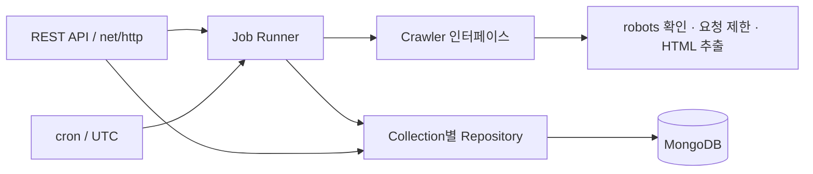

# SSU 공지 모아보기

슈캐치·글로벌미디어학부 공지를 Go + MongoDB Atlas 기반으로 통합 조회하는 로컬 MVP입니다. AI 요약, 날짜 정밀도를 보존한 일정, 원문 근거와 출처를 제공합니다. 현재 저장된 공고는226건이며 기본 노출75건입니다(2026-11-07 검증).

## 웹서비스 시작

Go1.27.3 및 기존 프로젝트 `.env`를 사용합니다. 프런트엔드는 Go embed로 제공하므로 별도 Node 빌드나 개발 서버가 필요하지 않습니다.

```sh
cd /Users/surfing_seal/Documents/ChatGPT/HCI
WEB_ADDR=127.0.0.1:8088 go run ./cmd/web
```

브라우저: http://127.0.0.1:8088 . 기존 `.env`의 `ADMIN_TOKEN`으로 로그인합니다. 토큰을 URL에 넣거나 공유하지 마세요. 새 인증정보를 만들거나 `.env`를 변경할 필요는 없습니다.

|환경변수|용도|
|---|---|
|MONGODB_URI|기존 Atlas URI, 서버에서만 사용|
|MONGODB_DATABASE|기존 ssu_crawler|
|ADMIN_TOKEN|24바이트 이상 기존 접근 토큰. Bearer 인증 또는 웹 로그인|
|WEB_ADDR|선택. 기본127.0.0.1:8080, 위 명령은8088. loopback IP만 허용|

`cmd/web`는 읽기 전용입니다. 크롤러/Runner/AI/cron을 초기화하지 않으며 Source/공고/분석/인덱스를 변경하지 않습니다. 기존 작업 실행 API가 필요한 `cmd/server`와 별도의 실행 명령입니다. 두 서버의 포트는 겹치지 않게 지정합니다.

검색(제목·요약·본문), 출처/공식 카테고리/원본 상태/일정 조건, 최신/마감/행사 정렬, 페이지 이동, 상세보기, 원문 근거와 안전한 링크를 지원합니다. 완료 공고는 기본 제외되고 상태=완료로 조회할 수 있습니다. 분석이 없는 공고와 검토 필요 일정도 구분합니다.

## 조회 API

- `GET /api/notices`
- `GET /api/notices/{24자리 ObjectID}`
- `GET /api/sources`
- `GET /api/categories`

기존 ADMIN_TOKEN의 Bearer 인증 또는 웹 로그인 세션이 필요합니다. 브라우저 로그인은 HttpOnly/SameSite=Strict 쿠키를 사용하고 HTML·JS에 토큰을 삽입하지 않습니다. [API 문서](docs/api.md), [웹 구조](docs/web-architecture.md), [2차 검증 결과](outputs/phase2-report.md)를 참고하세요.

## 웹 개발·검증

```sh
go test -count=1 ./...
go test -race -count=1 ./...
go vet ./...
go build ./...
TEST_MONGODB_URI=mongodb://127.0.0.1:27030 go test -count=1 ./internal/repository
```

마지막 명령은 새로 생성한 loopback 임시 DB만 사용합니다. 운영 Atlas를 TEST_MONGODB_URI로 지정하면 보호 검사에서 거부됩니다.

선택적인 Chrome E2E 검증(실행 중인 웹서버와 기존 `.env` 필요):

```sh
npm install --prefix /tmp/ssu-web-e2e --no-audit --no-fund playwright-core@1.65.0
NODE_PATH=/tmp/ssu-web-e2e/node_modules node scripts/web-e2e.cjs
```

설치된 Google Chrome을 사용합니다. 다른 설치 위치는 CHROME_PATH, 서버 주소는 WEB_BASE_URL, 산출물 위치는 E2E_OUTPUT으로 지정합니다. 실제 학교/AI 요청 없이 로컬 API를 검증하며 테스트용 오류503은 브라우저에서만 주입합니다. 스크린샷과 결과는 outputs/phase2에 생성됩니다. Node는 웹서비스 실행 의존성이 아닙니다.

## 기존 수집 서버와 운영 도구

아래 문서는 기존 수집·저장 서버에 대한 설명입니다. 읽기 전용 웹서비스에는 해당 서버의 자동 초기화 절차가 적용되지 않습니다.

Go 수집 서버는 공통 Crawler/Fetcher/Repository와 사이트별 실제 파서를 사용합니다. 상세 수집 및 분석 단계는 docs/data-pipeline.md와 docs/global-media-crawler.md에 기록되어 있습니다.

## 설계와 디렉터리



```text
cmd/server/main.go             구성 요소 연결, 서버 시작 및 종료
internal/config/              환경 변수·다중 source JSON 로드·검증
internal/model/               공통 BSON/JSON 모델, 조회 필터
internal/crawler/             Crawler, 공통 Fetcher/Session, Registry/Factory, 예제 파서
internal/fixture/             실제 개인정보 없는 테스트 HTML 서버
internal/service/             작업 실행·동시성·취소, cron 스케줄러
internal/repository/          연결·인덱스, Sources/Jobs/Contents Repository
internal/api/                 인증·HTTP 요청 검증·JSON 응답
configs/sources.example.json  자동 실행이 꺼진 다중 사이트 설정 예제
scripts/smoke.py               실행 중인 데모 서버의 종단간 검증
Dockerfile                    비루트 사용자로 실행하는 다단계 이미지
docker-compose.yml            인증된 MongoDB와 애플리케이션
.env.example                  환경 변수 예제
docs/validation.md            실행한 검증 결과와 한계
```

HTTP 계층은 입력을 검증하고 조회는 Repository에, 작업 실행은 Runner에 위임합니다. 크롤러는 DB와 HTTP API를 알지 못합니다. `Crawler.Crawl(ctx, source)` 구현을 등록하면 사이트별 파서를 추가할 수 있습니다. 초기에는 단일 API/Worker 프로세스로 운영하며, 추후 Runner 진입점과 Repository를 재사용해 Worker를 분리할 수 있습니다.

### MongoDB를 사용하는 이유

사이트마다 회사·직무·경험 유형 등의 속성이 다르므로 `metadata`에 확장 속성을 저장하기 좋습니다. 공통 필드는 Go 구조체로 고정하고 필수값을 저장 전에 검사합니다. 유연한 스키마가 무검증 저장을 의미하지는 않습니다. 콘텐츠 URL 고유 인덱스와 원자적 Upsert를 이용하며, 100건 단위 BulkWrite로 DB 왕복을 줄입니다. 현재 metadata 값은 문자열로 제한했습니다. 복잡한 중첩 속성이 필요해지면 명시적인 모델 변경을 합니다.

| 컬렉션 | 주요 필드 | 인덱스·역할 |
|---|---|---|
| `crawl_sources` | `_id`, `name`, `base_url`, `enabled`, `auto_enabled`, `crawler_type`, `list_url`, 요청 한도, `schedule`, `last_crawled_at`, 생성·수정 시각 | name unique; 대상 및 일정 |
| `crawl_jobs` | source_id, status, 시작·종료 시각, deadline, 수집·오류 수, 오류 요약 | source_id + started_at 내림차순; status=running 조건에서 source_id unique |
| `crawled_contents` | source_id, title, content, original_url, category, tags, published_at, crawled_at, updated_at, content_hash, metadata | original_url unique; source_id+crawled_at+_id; category+published_at; crawled_at+_id |

모든 시각은 UTC, ID는 BSON ObjectID이며 JSON에서는 24자리 hex 문자열입니다. 조회 기간은 콘텐츠의 `crawled_at`, 작업의 `started_at`에 적용합니다. `published_at`은 사이트가 제공하지 않으면 null입니다. `last_crawled_at`은 마지막 **종료한 시도**의 시각이며 성공만을 뜻하지 않습니다. 성공 여부는 작업 기록을 조회합니다.

### 데이터 흐름과 실패 처리

1. 시작 시 설정 파일을 검증하고 MongoDB Ping 및 인덱스 생성, 환경 변수의 예제 source와 다중 사이트 설정을 Upsert합니다.
2. 수동 요청은 enabled, cron은 enabled와 auto_enabled를 확인합니다. Registry가 crawler_type(기존 문서는 name)으로 구현체를 선택하고 Worker 슬롯을 확보합니다.
3. running 작업을 삽입합니다. 부분 고유 인덱스가 동일 source의 동시 실행을 DB 차원에서 거절합니다.
4. robots.txt를 확인한 뒤 목록·상세·페이지네이션을 순서대로 수집합니다. 상대 주소와 공백을 정규화하고 동일 URL 방문을 생략합니다.
5. 크롤러의 변경 감지 해시와 정규화한 URL로 원자적 Bulk Upsert합니다. 같은 URL·같은 해시는 last_seen_at과 새 분류 멤버십만 반영하고, 다른 해시는 변경 필드와 updated_at을 갱신합니다. `_id`와 최초 crawled_at은 유지합니다. 다른 URL의 같은 본문을 강제로 합치지 않습니다.
6. 작업 성공/실패와 source의 마지막 시각을 기록합니다. 종료 때 작업을 취소하며 취소된 Context와 별개로 최종 상태 저장에 10초를 부여합니다.

수집 중 오류가 발생하면 해당 실행의 수집 결과는 저장하지 않습니다. 저장 단계의 BulkWrite는 전체 실행에 대한 트랜잭션이 아니므로, 일부 배치가 저장된 뒤 실패할 수 있습니다. 실패 작업의 collected_count는 0으로 보고하며, 재실행하면 URL Upsert로 수렴합니다. error_count는 실행 수준 오류 수(실패 시 1)입니다. Fetcher 오류는 API/DB 작업 기록에 error_code, error_stage 및 URL 쿼리·사용자 정보를 제거한 요약을 남깁니다. 나머지 오류는 일반화된 요약과 서버 로그를 사용합니다.

프로세스 비정상 종료 후에는 다음 실행 시 동일 source의 만료된 running 작업을 failed로 전환합니다. deadline은 작업 시작 + JOB_TIMEOUT + 30초이며 원래 작업은 Context 제한을 지켜야 합니다. 다중 인스턴스 환경은 시계 동기화가 필요합니다. 만료 전에는 재실행을 거부합니다. 자동 재수집은 다음 cron/수동 실행을 사용하며, 내구성 있는 대기 큐는 없습니다. 기존 데이터에 deadline 없는 running 기록이 있다면 운영자가 상태를 확인한 뒤 정리해야 합니다.

## 실행

Go 1.27.3 이상, Docker 및 Compose가 필요합니다.

```sh
cp .env.example .env
# .env의 ADMIN_TOKEN과 MONGO_PASSWORD를 각각 openssl rand -hex 32 결과로 변경
# MONGO_PASSWORD는 URI 인코딩이 필요 없는 hex 문자열 사용
# 최초 데모는 DEMO_MODE=true 유지
docker compose up --build -d
docker compose logs -f app
```

MongoDB 포트는 호스트에 공개하지 않고 API는 호스트 127.0.0.1:8080에 바인딩합니다. Compose의 계정은 로컬 개발용 root 계정입니다. 운영에서는 전용 최소 권한 계정과 TLS를 적용해야 합니다. Compose 기본 이미지는 MongoDB 7.0입니다. 검증 환경의 Docker 커널 7.0.12에서 MongoDB 8.0 이미지가 시작을 거부하여, [공식 호환성 표](https://jira.mongodb.org/browse/SERVER-125742)에 따라 호환되는 기본값을 선택했습니다. 호환 커널에서는 `MONGODB_IMAGE=mongo:8.0`으로 선택할 수 있습니다. 기존 데이터 volume의 DB 버전은 임의로 낮추지 마세요.

MongoDB 데이터는 named volume에 남습니다. 종료는 `docker compose down`입니다.

데모는 프로세스 내부의 `127.0.0.1:8090`에 합성 HTML을 제공합니다. 해당 **정확한 origin만** 사설 주소 차단 예외로 허용하며 바인딩 실패 시 시작하지 않습니다. 이 포트는 Compose에서 외부에 공개하지 않습니다. 실제 수집 시 `DEMO_MODE=false`, `SOURCE_URL=https://승인된-대상/목록`을 설정하고 HTML 구조에 맞는 크롤러를 등록합니다. SOURCE_URL은 API 입력으로 받지 않습니다.

로컬 MongoDB를 사용하는 경우:

```sh
export ADMIN_TOKEN="$(openssl rand -hex 32)"
export MONGODB_URI='mongodb://localhost:27017'
export DEMO_MODE=true
go run ./cmd/server
```

환경 변수 전체는 [.env.example](.env.example)에 있습니다. `.env`는 Compose가 읽으며 `go run`에서는 셸 환경 변수를 직접 내보내야 합니다. 비밀값 파일과 캐시는 Git/Docker 컨텍스트에서 제외합니다.

## API

`/health`를 제외한 모든 API는 단일 관리자 권한의 Bearer Token이 필요합니다. 현재 일반 사용자 역할은 없습니다. 토큰은 서버 시작 시 24바이트 이상이어야 합니다. 운영망에서 TLS 프록시 뒤에 배치합니다.

| 메서드 | 경로 | 동작 |
|---|---|---|
| GET | `/health` | MongoDB Ping 포함, 정상 200 / DB 장애 503 |
| GET | `/api/v1/sources` | 대상 목록 |
| POST | `/api/v1/jobs` | `{"source_id":"24자리 hex"}`, 비동기 202 + Location |
| GET | `/api/v1/jobs` | 최신 실행 기록 |
| GET | `/api/v1/jobs/{id}` | 작업 상세 |
| GET | `/api/v1/contents` | 최신 수집 콘텐츠 |
| GET | `/api/v1/contents/{id}` | 콘텐츠 상세 |

목록 응답은 `{"items":[],"page":1,"limit":20}`입니다. source 목록은 배열입니다. `page`는 1~10000, `limit`는 1~100. `source_id`, `from`, `to`를 jobs/contents에 사용할 수 있고 contents에는 `category`, `source`(source_name)도 사용할 수 있습니다. 날짜는 RFC3339, 양 끝 포함이며 정렬은 시각 및 `_id` 내림차순입니다. 전체 건수는 매번 집계하지 않습니다.

```sh
# ADMIN_TOKEN은 .env와 같은 값으로 셸에 설정
curl -H "Authorization: Bearer $ADMIN_TOKEN" http://localhost:8080/api/v1/sources
# 응답의 source id 사용
curl -X POST http://localhost:8080/api/v1/jobs \
  -H "Authorization: Bearer $ADMIN_TOKEN" -H 'Content-Type: application/json' \
  -d '{"source_id":"여기에_source_id"}'
curl -H "Authorization: Bearer $ADMIN_TOKEN" \
  'http://localhost:8080/api/v1/contents?category=employment&page=1&limit=20&from=2026-01-01T00:00:00Z'
curl -H "Authorization: Bearer $ADMIN_TOKEN" http://localhost:8080/api/v1/jobs
```

잘못된 ID/입력은 400, 인증 실패 401, 대상 없음 404, 중복 실행 또는 Worker 포화는 409, 비활성/미지원 source는 422, 내부 오류는 500입니다. 알 수 없는 조회 키와 중복 파라미터를 거절합니다. HTTP 요청으로 MongoDB 필터 자체를 받지 않으며 서버가 타입이 정해진 조건만 조립합니다.

## 요청 제한과 보안

- 요청별 Timeout, 실행 전체 Timeout, Context 취소, 크기 제한(응답 2MiB, 작업 요청 4KiB), source별 페이지·상세·총 요청 수 제한.
- 동일 origin의 요청 시작 간격과 진행 중 요청 수를 Fetcher에서 공유합니다. 기본 간격 1초·동시 요청 1개이며 robots Crawl-delay가 더 길면 적용합니다.
- 일시적 네트워크 실패·429·5xx에 총 3회 이내 요청, 1초·2초 지수 대기. 429/503의 Retry-After(초 또는 HTTP 날짜)는 더 긴 대기 및 origin 전체 cooldown에 적용합니다. 모든 대기는 Context로 취소됩니다. 401/403은 재시도하지 않습니다.
- robots.txt 404는 규칙 없음으로 취급하며 나머지 오류는 수집을 중단합니다. robots에서 금지한 경로에는 요청하지 않습니다.
- HTTP(S), 표준 포트, 동일 origin 링크만 허용합니다. 페이지 redirect는 최대 5회까지 각 대상의 origin·robots·DNS·요청 예산을 검사해 따라갑니다. robots.txt redirect는 fail-closed로 중단합니다.
- 실제 접속 직전 DNS 결과에서 비공개/예약 주소를 검사하고 검사한 IP로 직접 연결합니다. 환경 프록시는 사용하지 않습니다. 배포망에서도 필요에 맞게 외부 접속을 제한할 수 있습니다.
- 수집 필드는 제목·본문·태그·게시일·허용된 metadata만 선택합니다. 쿠키·로그인·CAPTCHA·접근 통제 우회 기능은 없습니다. 실제 사이트 추가 전 운영자가 이용 정책과 허용 범위, 개인정보 포함 여부 및 보존 정책을 확인해야 합니다.

현재 origin별 요청 제한과 Worker 수 제한은 **프로세스 단위**입니다. 동일 source 중복 방지는 MongoDB 전체에 적용되지만, 여러 프로세스의 동일 사이트에 대한 통합 rate limit은 구현하지 않았습니다. 초기 배포는 app 한 인스턴스를 사용합니다.

## 테스트

```sh
go test -race -cover ./...
go vet ./...
go build ./cmd/server
go run golang.org/x/vuln/cmd/govulncheck@latest ./...

# 별도 테스트 MongoDB. 테스트는 임의 이름의 crawltest_<ObjectID> DB만 생성/삭제합니다.
TEST_MONGODB_URI='mongodb://localhost:27017' go test -race ./...

# DEMO_MODE 서버가 실행 중일 때
ADMIN_TOKEN='서버와_동일한_토큰' python3 scripts/smoke.py
```

TEST_MONGODB_URI가 없으면 실제 MongoDB를 사용하는 테스트는 명시적으로 skip합니다. 단순 연결 실패 테스트는 항상 실행합니다. 최초 실행 결과는 [검증 기록](docs/validation.md), 이번 확장 결과와 변경 파일은 [기반 작업 검증 기록](docs/foundation.md)에 정리했습니다.

## 라이브러리 선택과 확장

- `net/http`, `slog`, Context, crypto, 인증 비교, 테스트는 표준 라이브러리를 사용합니다.
- 공식 MongoDB Go Driver **v2**: 연결 풀, BSON ObjectID, 인덱스, BulkWrite. API는 [공식 연결 문서](https://www.mongodb.com/docs/drivers/go/current/connect/mongoclient/)와 [Bulk 작업 문서](https://www.mongodb.com/docs/drivers/go/current/crud/bulk/)를 참고했습니다.
- `goquery`: CSS 선택자 기반 HTML 추출. Colly와 중복되는 요청 수명주기 계층을 추가하지 않고 SSRF·취소·재시도를 직접 제어했습니다.
- `robfig/cron/v3`: 검증된 5필드 cron 파서. UTC 기준, 시작 시 source별 등록, 일정 변경 후 재시작이 필요합니다. 포화 시 해당 회차는 건너뛰고 로그를 남깁니다.
- `robotstxt`: User-agent 그룹 및 경로 규칙 해석. 직접 robots 파서를 작성하지 않습니다.
- chromedp는 미도입입니다. JavaScript가 필수인 승인된 대상이 확정되면 별도 Crawler 구현으로 추가하고 브라우저 네트워크 전체에도 동일한 접근 정책을 적용해야 합니다.

새 사이트는 아래 Registry 등록 및 JSON 설정 절차를 사용합니다. source 설정을 관리하는 CRUD API는 추가하지 않았으며 시작 시 설정을 반영합니다. 실제 사이트 크롤러, JS 렌더링, 분산 작업 큐, 분산 rate limit, OAuth/RBAC, 콘텐츠 보존/삭제 정책 자동화, 대규모 부하 테스트는 구현하지 않았습니다.


## 여러 사이트 등록과 하위 호환성

```sh
cp configs/sources.example.json configs/sources.json
# 로컬 실행 환경에서
export CRAWL_SOURCES_FILE="$PWD/configs/sources.json"
# 그 외 ADMIN_TOKEN/MONGODB_URI 설정 후 서버 시작
```

Compose에서는 `.env`에 `CRAWL_SOURCES_FILE=/app/configs/sources.json`을 설정합니다. `./configs`가 읽기 전용으로 컨테이너에 마운트됩니다. 샘플의 `.invalid` URL은 자리표시자이며 enabled=false, auto_enabled=false입니다. 설정 로드·검증은 DNS 조회나 HTTP 요청을 하지 않습니다. 실제 대상의 허용 범위를 확인한 뒤 URL·파서를 준비하고 enabled를 켭니다.

| JSON 키 | 의미 및 기본값 |
|---|---|
| id | 선택적인 24자리 BSON ObjectID. 생략하면 unique name으로 기존 문서를 찾고 신규 ID 생성 |
| name | 고유한 사이트 이름, 영문/숫자로 시작하는 1~64자의 영문·숫자·밑줄·하이픈 |
| crawler_type | Registry에 등록된 타입, 필수. 사이트 이름과 독립적이며 여러 source가 같은 타입 사용 가능 |
| base_url | HTTP(S) 기준 URL, 필수. 실제 대상은 공개 주소와 표준 포트 사용 |
| list_url | 절대 URL 또는 base_url 기준 상대 주소. 생략하면 base_url. 동일 origin만 허용 |
| enabled | 사이트 사용 가능 여부, 기본 true. false이면 수동·자동 실행 모두 차단 |
| auto_enabled | 자동 스케줄 활성화, 신규 설정 기본 false. false여도 enabled=true이면 수동 실행 가능 |
| request_interval | 요청 시작 간격, 기본 1s. 1ms~24h, 밀리초 단위. DB/API에는 request_interval_ms로 저장·노출 |
| max_pages | 기본 1, 1~10000 |
| max_contents | 기본 3, 1~10000 |
| max_requests | 기본 20, 1~100000. robots·실패한 연결 시도·재시도·redirect를 모두 포함한 실행별 예산 |
| max_concurrency | 기본 1, 1~16. 같은 origin의 동시 요청 수 |
| schedule | UTC 기본 `0 */6 * * *`, auto_enabled=false여도 문법 검사 |

수치 제한의 0은 생략과 같은 기본값으로 처리합니다. 기존 BSON 문서에서 누락된 한도는 예전 값인 페이지 100·상세 1000·총 요청 10000·간격 1초·동시성 1을 사용하며, 신규 JSON 설정의 기본값은 표와 같이 소량으로 제한합니다. 음수·범위 초과, 중복 name/ID, 알 수 없는 JSON 키, 다른 origin의 목록 URL, 잘못된 cron/ID/간격을 거절합니다. 파일은 최대 1MiB·100개 source이며 알 수 없는 crawler_type은 시작 시 오류로 처리합니다. 설정 파일에서 빠진 DB 문서는 삭제하거나 비활성화하지 않으므로 중단하려는 source는 enabled=false로 명시합니다. 설정 반영 후 서버를 재시작합니다.

명시한 설정 필드는 재시작 시 DB에 다시 적용합니다. 기존 `_id`, created_at, last_crawled_at 및 실행 기록은 보존합니다. ID를 생략한 source의 name을 변경하면 신규 source가 되므로, 이름을 변경하면서 ID를 유지하려면 기존 id를 지정합니다. 다른 ID가 기존 name을 차지하려 하면 실패합니다.

기존 SOURCE_URL/SOURCE_SCHEDULE은 계속 `example` source를 설정합니다. 기존 환경 변수와 DEMO_MODE가 사용하는 name=example은 다중 설정에서 중복 등록할 수 없습니다. 신규 SOURCE_URL source의 자동 실행은 기본 false, 데모 신규 source는 기존처럼 true입니다. 이미 저장된 auto_enabled는 legacy seeding으로 덮어쓰지 않습니다.

기존 BSON에 crawler_type이 없으면 name을 타입 키로 사용합니다. crawler_type과 auto_enabled가 모두 없는 기존 문서는 기존 스케줄 동작을 유지합니다. 새 타입이 명시된 문서는 auto_enabled를 생략해도 자동 실행되지 않습니다. 기존 문서도 자동 실행을 끄려면 auto_enabled=false로 명시합니다. 필드 추가만 사용하며 별도 파괴적 마이그레이션은 없습니다. 기존 REST 경로·요청 본문·기존 응답 필드는 유지하고 source 설정 및 작업 오류 필드만 추가합니다.

## 사이트 크롤러 추가 방법

1. `internal/crawler/<사이트명>.go`에 기존 `Crawler` 인터페이스를 구현합니다. 사이트별 선택자·게시물 ID·날짜 형식은 이 구현에 둡니다.
2. 공유 Fetcher를 주입하고 **Crawl 호출당 Session 하나**를 생성합니다. 직접 net/http 클라이언트를 새로 만들면 공통 정책을 우회하므로 사용하지 않습니다.

```go
session, err := c.Fetcher.NewSession(source)
if err != nil { return nil, err }
defer session.Close()
page, err := session.Get(ctx, session.ListURL())
if err != nil { return nil, err }
// page.Body를 goquery로 파싱하고 page.URL을 상대 링크의 기준으로 사용합니다.
// 다음/상세 링크는 session.Resolve(page.URL, href)로 검증한 뒤 Get합니다.
```

3. 파서는 `source.WithDefaults()`의 MaxPages/MaxContents를 확인하고 한도에 도달하면 정상 종료합니다. Session이 총 요청 수와 HTTP 동시성을 제한합니다. HTTP 예산을 초과하면 request_limit 오류이며 해당 실행의 수집 결과는 저장하지 않습니다.
4. 공통 `model.Content`로 변환합니다. 제목·본문·원본 URL은 필수, 게시일은 없으면 nil, metadata는 허용한 문자열 필드만 수집합니다. 기존 example처럼 정규화된 제목+본문의 SHA-256을 설정합니다. URL Upsert 저장 로직은 이번 작업에서 변경하지 않았습니다.
5. `internal/crawler/builtins.go`의 DefaultRegistry에 Factory를 등록합니다. main, Runner, HTTP Handler, 스케줄러를 바꾸지 않습니다. 예를 들어 `CareerSite` 구현을 추가했다면 다음 등록을 사용합니다.

```go
if err := r.Register("career-site", func(source model.Source) (Crawler, error) {
    return &CareerSite{Fetcher: f}, nil
}); err != nil { return nil, err }
```

6. JSON 설정에 `crawler_type: "career-site"`와 고유 name을 등록합니다. 기존 example 타입과 fixture HTML은 그대로 사용할 수 있습니다.
7. httptest와 로컬 HTML로 테스트한 뒤, 승인된 실제 대상에 대해 수동 소량 실행으로 확인하고 마지막에 auto_enabled를 켭니다.

Factory는 동시에 호출되어도 안전해야 합니다. Fetcher의 Timeout/FixtureOrigin은 서버 시작 전에만 설정합니다. FixtureOrigin은 코드가 시작한 정확한 로컬 fixture 전용이며 JSON·API 설정으로 예외를 열 수 없습니다. Registry의 중복 타입 등록과 미등록 타입 선택은 오류입니다. 런타임 플러그인 로딩은 제공하지 않으므로 새 Go 구현을 추가하면 다시 빌드합니다.

## 실제 사이트 연결에 필요한 정보

- 사이트 이름, 목록 URL과 상세 URL 예시, 페이지네이션 방식.
- 수집할 제목·본문·분류·태그·날짜·metadata 범위 및 개인정보 제외 기준.
- robots.txt와 이용 정책의 위치·검토 결과, 허용 경로·요청 간격·접근 제한.
- 로그인 없이 서버 HTML에서 필요한 내용을 얻을 수 있는지 여부. JS 전용 사이트는 현재 파서로 처리하지 않습니다.
- 게시물 식별에 필요한 쿼리 파라미터·canonical URL·게시물 ID와 날짜의 시간대.

실제 대상은 등록 직후 자동 실행하지 않습니다. 목록 1페이지·상세 최대 3건·동시 요청 1개로 시작하고 정책이 요구하는 간격 이상을 적용합니다. 이번 기반 작업에서는 외부 사이트를 요청하지 않았으며 httptest의 합성 HTML만 수집했습니다.

Fetcher는 origin(스킴+정규화된 host/port)별로 간격과 동시성 상태를 공유하며, 같은 origin에서 서로 다른 제한을 사용하는 Session이 만들어지면 더 긴 간격·더 낮은 동시성을 유지합니다. 제한을 완화하려면 재시작합니다. robots는 실행별 Session에서 한 번 확인하며 404 외 오류나 redirect에는 수집을 중단합니다. 여러 프로세스 간 rate limit은 여전히 제공하지 않습니다.


## SSU:catch 로컬 MVP

`ssu_catch` 구현과 비활성 설정 `configs/sources.ssu-catch.json`을 추가했습니다. 실제 목록 HTML의 15행 파싱과 합성 상세 Fixture 기반 실제 MongoDB·Job Runner·API 테스트를 구현했습니다. **실제 상세 본문 DOM과 수집/재이용 허용 범위는 미확인으로 외부 수집을 중단했습니다. 실제 공지 저장 성공은 0건입니다.** 상세 선택자를 추측해 넣지 않았으며 정책 미승인/선택자 미설정 시 HTTP 전에 중단합니다. 자동 스케줄은 SSU MVP 코드에서도 차단합니다.

필드·카테고리 배열·해시별 저장 규칙·실제 요청 원장·검증 결과·재개 조건은 [SSU 검증 기록](docs/ssu-catch.md)을 참조하세요. `category` 필터는 scalar와 categories 배열을 모두 조회합니다. 기존 original_url Unique Index를 유지하며 정규화 URL을 저장합니다. 운영 DB의 기존 비정규 URL을 자동 일괄 변경하지는 않습니다.

## 실제 상세 HTML Fixture 준비 (2026-11-06)

기존 로컬 MVP를 보존한 작업 복사본이다. 실제 상세 선택자는 아직 미확인이며
`policy_approved=false`와 비활성 설정을 유지한다.
브라우저 HTML 저장 경로, 검토 양식, 실제 Fixture 테스트 및 MongoDB 저장 테스트는
[실제 상세 Fixture 안내](docs/detail-fixture.md)를 따른다.

사용자 제공 실제 상세 HTML을 확보하여 해당 페이지의 제목·본문·첨부 선택자와
목록 기반 등록부서 연결을 검증했다. 최신 상태는 위 상세 Fixture 안내를 참조한다.
실사이트 수집 설정은 여전히 비활성이다.

## Vertex AI 수동 분류

Google Gen AI Go SDK의 Vertex AI 분류기, 엄격한 JSON 검증, 중복 호출 방지 저장 및
인증 분류 조회 API를 추가했다. 일반 실행·테스트는 유료 모델을 호출하지 않는다.
[설정·수동 명령·실제 연결 상태](docs/vertex-classification.md)를 참조한다.

## 분류 품질 평가

[평가 데이터·사람 정답·검토 사유·지표 안내](docs/classification-evaluation.md)에 따라
mock/replay 평가를 실행할 수 있다. 기본 평가에는 실제 모델 호출이 없다.
실제 1건의 사용자 정답과 합성 13건의 에이전트 참조 라벨을 분리해 보고한다.

## 현재 분류 정책

슈캐치는 공식 카테고리의 source 전략을 사용하며 AI를 호출하지 않는다. 채용·교원채용은
수집 대상에서 제외한다. 학과의 미분류 공지는 Source별 ai/hybrid 전략과 명시적 수동
실행으로만 처리한다. 최종 분류는 공식 8개 및 검토 표식 unknown으로 통일한다.
[전략·저장 규칙·수동 테스트](docs/classification-strategies.md)를 참조한다.

## 글로벌미디어학부 Source

`configs/sources.university.json`으로 기존 SSU와 신규 hybrid Source를 함께 등록할 수 있습니다. 두 Source의 수집 승인은 false이며 자동 수집은 비활성화되어 있습니다. 실제 상세 API 응답 검토가 완료될 때까지 신규 크롤러는 요청 전에 차단됩니다. 실제 정적 HTML 조사와 합성 Fixture 검증의 범위 및 수동 분류 명령은 [global-media.md](docs/global-media.md)를 참고하세요.

## 슈캐치 최근 3개월 수집

공식 8개 카테고리의 Preview 및 승인된 수동 실행은 [사용 안내](docs/ssu-recent.md)를 참고하세요. 기본 Preview는 HTTP·DB 작업을 하지 않으며 자동 스케줄을 활성화하지 않습니다.

## 슈캐치 완료 공고 목록 노출

슈캐치 원본 status=완료 공고는 기본 목록에서 제외하고 `include_completed=true`로 조회할 수 있습니다. 상태/기한 데이터는 바꾸지 않습니다. [Source 범위·만료 필터 조합·읽기 전용 Preview](docs/completed-visibility.md)를 참고하세요.

## 공개 저장소와 로컬 전용 자료

공개 저장소에는 코드·문서·합성 테스트 데이터만 포함합니다. 실제 수집 HTML, 학교 공고 본문 코퍼스, 유료 모델 raw_response, outputs의 실험/DB 백업과 인증정보는 로컬에 유지합니다. 해당 자료가 없는 새 clone에서는 실제 캡처 기반 회귀 테스트가 사유와 함께 SKIP되며 합성/Mock 테스트는 실행됩니다. 로컬 자료를 보유한 환경에서는 동일 테스트가 정상 실행됩니다. `REQUIRE_LOCAL_FIXTURES=true go test ./...`는 필수 로컬 자료가 없으면 실패하도록 검사합니다.

실데이터 DB와 `.env`는 clone에 제공되지 않습니다. `.env.example`을 참고해 본인 환경을 설정하세요. 이전 실행 보고서는 로컬 `outputs/`에만 있습니다.
